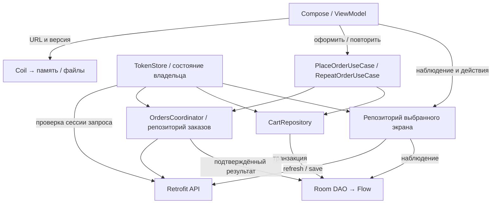

# CoffeeRun — план перехода к локальному хранению

**Цель** — сохранить покупки при перезапуске, показывать доступные данные при сбое сети и исключить смешение аккаунтов. Основание — [24 пункта аудита](../../PRE_ROOM_AUDIT.md). Это предлагаемая архитектура. Состав первой сдачи и требование к гарантированно доступным фотографиям пока открыты.

**Стек проекта** — Kotlin, Compose, Retrofit/OkHttp, DataStore Preferences, Coil и ручной AppContainer. Предлагаем добавить Room и совместимый с текущими Kotlin/AGP процессор KSP в первом срезе с таблицами. Существующие координаторы заказов и избранного продолжают задавать порядок операций. Для реализации по этому документу подходит последовательное выполнение небольшими задачами (superpowers:executing-plans).

## Какие данные куда попадут

| Данные | Предлагаемое место и ключ | Срок жизни, авторитет и поведение без сети |
|---|---|---|
| Токен и идентификатор локального входа | Одна запись DataStore. Пароль только в памяти формы | Записываются при успешном входе, очищаются при выходе/актуальном 401. Сохранённая сессия позволяет читать свой кэш офлайн. Сервер подтверждает права на сетевую операцию. |
| Выбранная кофейня | Отдельная настройка DataStore по стабильному коду Shop | Предлагается настройка устройства, общая для гостя и следующего входа. В checkout явно виден адрес. Если нужна приватность выбора, перенести в область владельца. |
| Корзина | Room. Владелец, стабильный ID строки, productId, количество, цена, точный рецепт, отображаемый снимок | Локальная БД определяет состав. Можно открыть, изменить количество и удалить без сети. Снимок позволяет показать удалённый товар, а сервер определяет возможность покупки. |
| Попытка оформления | Room рядом с корзиной. Уникальный clientRequestId, владелец, неизменяемый снимок строк с их ID, адрес/время, состояние и номер заказа | Сохранить до POST. Переживает перезапуск, сетевые повторы и очистку обычного кэша. После завершения хранить минимум данных для восстановления результата. |
| Профиль | Опциональная таблица Room по владельцу, имя, телефон, время последнего подтверждения | Последний успешный GET/PUT. Офлайн доступен просмотр. Черновик отделён от подтверждённых данных, сохранять изменение на сервере можно при связи. Без требования офлайн-профиля тот же наблюдаемый контракт работает в памяти. |
| Каталог и цены | Опциональный снимок Room по языку, с версией/временем получения. Товары и опции одной редакции | Публичный, может переживать выход. Офлайн возможны просмотр и сбор корзины по сохранённым условиям. Новую цену подтверждают перед покупкой. |
| История и избранное | Опциональные таблицы Room с составными ключами владельца и номера заказа либо productId | Подтверждённые сервером данные. История хранит оплаченные строки. Офлайн доступен просмотр, сетевые действия выполняются явно. |
| Обычные фото товаров | Ограниченный дисковый кэш Coil и кэш памяти. В записи товара — URL и версия, если сервер её предоставляет | Публичные фото допускают вытеснение. Картинка может отсутствовать при сохранённом товаре. Удаление фото не затрагивает корзину и профиль. |
| Фото, обязательные для офлайн-показа | Только при подтверждённом требовании — отдельные файлы приложения, в Room индекс по ключу ресурса, версия, размер, состояние. Альтернатива при требовании хранить именно байты в SQL — отдельная таблица ограниченных миниатюр BLOB | Выбор зависит от объёма, допустимого размера миниатюры и требования лабораторной. Оценить общий объём, время старта, чтение списка и очистку. Будущие частные фото требуют пространства владельца и удаления при выходе. Аватара в текущем API нет. |

**Предложение для первого выпуска:** корзина, выбранная кофейня и безопасный исход оформления. Если для демонстрации нужны пользовательские данные в Room, ближайший независимый срез — профиль. Если нужен сценарий «открыть меню в авиарежиме», подключить каталог и обычный кэш фото. Если условие звучит как «все фото доступны после очистки кэша», выбрать отдельное хранение файлов или ограниченных миниатюр. При обязательном хранении истории/избранного добавить соответствующий срез ниже. Это разные критерии приёмки.

## Поток данных после изменений

У каждой подключённой области один путь чтения для всех экранов. GET/PUT обновляет таблицу после проверки ответа и владельца, Room уведомляет подписчиков. Для избранного временное оптимистическое значение накладывается на подтверждённый снимок до завершения операции. Флаги загрузки, ошибка обновления и черновик формы живут отдельно. Это позволяет одновременно показать имеющиеся данные, время обновления и кнопку повтора.

### Ключи и границы транзакций

- **Владелец.** С текущим API предложен случайный локальный идентификатор входа. Он сохраняется вместе с токеном, переживает перезапуск и меняется даже при том же тексте токена после нового login. Телефон редактируем, номер заказа уникален лишь в пределах владельца. Для общего кэша одного аккаунта между повторными входами потребуется постоянный серверный userId и согласованная политика хранения. Поколение процесса из SessionStateStore сохранить для отбрасывания старых ответов.
- **Переход между владельцами.** Хранить в DataStore текущий owner и незавершённый переход с исходным owner. При старте показывать закрытое состояние до сверки с Room. В транзакции БД переключать активный owner, переносить только допустимую гостевую корзину при входе, удалять частные строки прежнего входа при выходе/замене. Затем завершать маркер DataStore. Оба шага повторяемы после остановки. Сериализовать переходы, немедленно скрывать частные экраны, проверять owner внутри каждой частной транзакции. Обновление старой установки с сохранённым токеном выдаёт локальный ID один раз до открытия БД. Потеря/нечитаемость маркера закрывает доступ к частным данным до восстановления.
- **Корзина.** Логическая схема первой версии — метаданные активного владельца, cart_line, checkout_attempt и строки снимка попытки. Первичный ID строки независим от productId. Ключ объединения включает owner, productId, цену и каноническое представление опций (отсортированные коды добавок, явные null, нормализованное примечание). Использовать условную запись с проверкой лимита внутри транзакции. Снимок названия/фото нужен для показа вне каталога. Удаление товара из каталога не каскадирует в корзину.
- **Серверные снимки.** Для каталога ключ товара — язык и ID, цены/наличие опций той же редакции. Для истории — owner и номер, для её строки — порядковый номер внутри заказа: один напиток может встречаться с разными рецептами. Хранить исходные коды незнакомых опций. Для частичного и полного снимков хранить раздельный признак полноты и время успешного обновления. Успешная деталь не объявляет полной всю историю.
- **Незавершённая покупка.** Запись попытки и снимка — одна транзакция. Сеть находится между транзакциями. Применение подтверждения — вторая транзакция: проверить владельца и неизменяемый ключ, зафиксировать номер, вычесть отправленные количества один раз и завершить попытку. При наличии кэша заказов обновить его в той же БД. Сохранённый ответ на повтор этой попытки не вычитает корзину второй раз.

## Порядок внедрения

Пункты аудита указаны в каждом шаге. Пути Kotlin ниже даны относительно `app/src/main/java/ru/coffeerun/`. Для каждого шага сначала воспроизвести указанный сценарий на старом поведении, выполнить изменение и проверить видимый результат. Это план будущей реализации.

### 1. Воспроизводимая база и контракт сети · № 1, 9, 17, 24

- [ ] Зафиксировать состав рабочего дерева вместе с незакоммиченным RepeatOrderUseCase. Выполнить `gradlew.bat :app:testDebugUnitTest :app:assembleDebug`. Сохранить базовые результаты отдельно от будущих тестов Room.
- [ ] В `docs/openapi.yaml` описать договорённости для idempotency key, сверки попытки, детального конфликта цены/наличия, стабильного userId и версий изображений по мере необходимости соответствующих срезов. Различать реализованные и предлагаемые поля. Обновлять вместе DTO, `CoffeeRunApi`, `mock/coffeerun.json`, README мока и тестовые ответы.
- [ ] В сетевых тестах с MockWebServer или управляемым состоянием фейка завести A/B, одинаковые номера заказов, раздельные отказы меню/заказов и обработчик «сохранить заказ, затем оборвать соединение». Проверить состояние на стороне сервера. Однопользовательский Mockoon сохранить для демонстрации.

### 2. Сессия, приватность, ошибки локального хранилища · № 2, 6, 22, 23

- [ ] Дополнить `data/local/TokenStore.kt`, `data/session/`, `ui/auth/SessionViewModel.kt`, `ui/CoffeeRunApp.kt`. Различать чтение, ошибку, переход между владельцами, готового гостя и готового владельца. Ввести протокол перехода выше. При старом 401 не очищать новый вход. При ошибке выхода показать закрытый экран с повтором операции.
- [ ] Применить изоляцию к данным и сохранённым навигационным вкладкам. В backup_rules.xml и data_extraction_rules.xml исключить приватную БД целиком и файл полномочий из облака и переноса. Публичный кэш допускает повторное заполнение. Не писать токены, имя, телефон, рецепты с примечаниями в диагностические логи.
- [ ] Проверить в TokenStoreTest и инструментальном тесте остановку после каждого шага переключения, старый 401, ошибку чтения и вход с тем же demo-token. После повторного запуска — ожидаемый owner, корректный гостевой перенос, ноль кадров с чужим профилем/корзиной.

### 3. Согласованный каталог и правила рецепта · № 3, 4, 7, 8, 11, 15–17

- [ ] В `data/MenuRepository.kt` развести наблюдение за снимком и принудительное обновление одного языка. Передавать тот же язык в Retrofit. На первом шаге реализация может быть в памяти. Одним обновлением публиковать продукты и цены для меню, карточки и повтора.
- [ ] В `data/network/MenuMappers.kt` и `OrderMappers.kt` проверить ключи, числа и итог, обработать битую ссылку локальной заглушкой, сохранить информацию о нераспознанном рецепте. В модели корзины исправить ключ объединения. Вынести общее правило доступности/расчёта из `RepeatOrderUseCase` и применить к quickAdd, форме товара и проверке checkout. Устаревший сохранённый выбор требует явного исправления.
- [ ] Проверить тестами NetworkMenuRepositoryTest, MenuViewModelTest, ProductViewModelTest, RepeatOrderUseCaseTest и OrderMappersTest: RU/EN в обратном порядке, обновление при открытой карточке, нет обязательного молока, удалена добавка только у одного напитка, неизвестная историческая добавка, отрицательная сумма, одинаковые ID, битая фотография.

### 4. Первая Room — корзина, адрес и попытки · № 1–6, 21, 23

- [ ] В `gradle/libs.versions.toml` и `app/build.gradle.kts` подключить Room runtime, compiler через KSP, средства тестирования и экспорт схемы. Создать `data/local/CoffeeRunDatabase.kt`, DAO и записи владельца, корзины, попыток по описанным ключам. Первую схему положить под контроль версий. Запретить разрушительный сброс пользовательских данных при несовместимой версии.
- [ ] Передавать CartRepository и ShopRepository через AppContainer. Контракт корзины предусматривает поток по активному владельцу, готовый снимок через suspend-чтение и пакетную запись с результатом по каждой строке. Для повтора проверка предела количества и добавление идут в одной транзакции, для checkout — вычитание по ID исходных строк. Не держать монитор SessionProvider во время дискового ввода-вывода. Выбранный адрес читать/писать через DataStore. Подстроить CartViewModel, ProductViewModel, CheckoutViewModel и фейки.
- [ ] Android-тест с файловой БД: заполнить, закрыть, открыть заново в авиарежиме. Проверить адрес, рецепт, цену и ID. Повторить у лимита, обновить перевод, удалить и добавить заново во время покупки, остановить процесс во время записи. Ошибка диска оставляет предыдущую корзину и даёт повтор. Начальное ожидание DAO не рисует «корзина пуста».

### 5. Безопасное оформление и восстановление · № 1, 4, 9, 20, 21

- [ ] В `domain/checkout/PlaceOrderUseCase.kt` проверить свежие цены/опции и время. При расхождении показать конкретные строки и новый итог. При повторном подтверждении проверить и текущую редакцию корзины. В момент отправки зафиксировать адрес и время на экране. Серверная проверка финальных условий обязательна для реальных заказов.
- [ ] Различать отклонено, отправляется, исход неизвестен и подтверждено. Закрытие checkout завершает ожидание экрана. Сведения о попытке доступны при возврате. Пока попытка неизвестна, действие ведёт к сверке или истории. Автоматическая отправка при появлении связи исключена.
- [ ] При наличии поддержки сервера сделать lookup по ключу и повтор того же тела с тем же ключом, привязанным к владельцу. Сервер должен атомарно закреплять результат, отклонять отличающееся тело с этим ключом и документировать срок действия ключа. По истечении срока — ручная проверка. Пока сервер этого не умеет, историю дать открыть даже при отказе меню; совпадение суммы и времени не является доказательством конкретной покупки.
- [ ] Предусмотреть выход из ручной сверки. Пользователь может оставить попытку для проверки позже или, после явного предупреждения о возможном дубле, начать отдельную покупку. Старую попытку этим действием нельзя помечать подтверждённой и вычитать её строки. После выхода из аккаунта сведения о попытке не передаются гостю или следующему входу; при отсутствии стабильного серверного userId проверка прежних покупок после повторного входа доступна через серверную историю.
- [ ] В PlaceOrderUseCaseTest и checkout UI-тесте воспроизвести потерю 201, 409, тайм-аут до ответа, закрытие экрана, перезапуск до локального commit и второй клик после возврата. С поддерживаемым контрактом получить один заказ на сервере и одно вычитание. Без контракта показать неизвестный исход и сохранить строки. При смене владельца исключить применение старой попытки.

### 6. Наблюдаемый профиль · № 2, 13, 14, 22

- [ ] В `data/ProfileRepository.kt` определить наблюдение за своим подтверждённым профилем, refresh и save. В `data/NetworkProfileRepository.kt` сериализовать обновления владельца или отсекать старые ответы версией. Успешный PUT с каноническими полями обновляет источник сразу. Для офлайн-профиля добавить профильную таблицу и миграцию. При минимальном объёме сохранять тот же контракт в памяти.
- [ ] В ProfileViewModel, EditProfileViewModel, Routes и CoffeeRunNavHost убрать зависимость отображения от PROFILE_SAVED и передачи name/phone в маршрут. Поля текущего черновика не перетирать фоновым GET. На тайм-аут PUT сохранить введённое, показать «Статус сохранения неизвестен» и сверить GET при доступной сети. При разных значениях показать серверное и предложить явное повторное сохранение.
- [ ] Проверить A → B с задержанным PUT, PUT 200 → GET 500, PUT с потерянным ответом, открытие профиля офлайн с кэшем и без него, отказ записи Room уже после успешного PUT. В последнем случае повторить локальную сверку, не выдавать ошибку БД за серверный отказ.

### 7. Кэш меню и фото · № 11, 15–18, 23

- [ ] Для офлайн-меню добавить таблицы снимка и его строк с языковым ключом. Обновлять в транзакции после полного разбора. Показывать последнее успешное меню сразу и обновлять при входе/по запросу с объединением одинаковых GET. При ошибке сохранять содержимое и показывать «Не удалось обновить». При отсутствии данных нужного языка явно обозначать запасной язык или предлагать повтор.
- [ ] В `CoffeeRunApplication.newImageLoader`, `ui/components/ProductCard.kt` и `ui/product/ProductScreen.kt` задать общую политику ключа, лимита диска и заглушек. Начать с кэша Coil, проверить фактическое чтение из диска после нового процесса. Для изменяемого URL использовать версионированный адрес от сервера либо HTTP-валидатор с проверкой обновления. Учитывать запрашиваемый размер у декодированной картинки. Кэширование полного каталога не должно запускать скачивание всех оригиналов при старте.
- [ ] Если требуются гарантированно сохранённые изображения, выбрать объём/разрешение/бюджет на реальных фото из mock/images. Записывать проверенный временный файл, затем публиковать готовое имя и индекс; при старте убирать сироты и восстанавливать отсутствующие файлы. При варианте BLOB читать байты отдельным запросом, исключить их из подписки списка. При нехватке места показать неполноту загрузки. До заявления «доступно офлайн» проверить наличие всех обещанных ресурсов.
- [ ] Сценарии приёмки: первая установка без сети, тёплый кэш и авиарежим, очистка кэша ОС, 404 одного изображения, версия фото изменилась, заполненный диск. Зафиксировать размер хранилища на наборе RU/EN и время показа списка при холодном запуске до и после. При вытеснении обычного фото товар остаётся читаемым.

### 8. История, подтверждение и избранное · № 8–10, 12, 19, 20

- [ ] В `data/NetworkOrderRepository.kt` отвязать заказы от обязательного меню. До появления серверных исторических названий сохранить доступный снимок и продуктовый ID. Представлять неизвестные статусы без разрешения отмены. Проверять частичную историю и 404 детали. При подключении Room хранить порядковые строки заказа, свежесть и полноту отдельно. Координатор сохраняет существующее упорядочивание place/cancel/refresh.
- [ ] В `ui/checkout/OrderPlacedViewModel.kt` наблюдать заказ по owner и номеру и разрешать восстановление только после проверки владельца. Навигацию старого входа сбрасывать. После возвращения на экран активного заказа обновлять статус при связи. В офлайне показывать момент последнего обновления.
- [ ] В FavoritesCoordinator различать неизвестный, подтверждённо пустой и устаревший набор. Для ошибки PUT/DELETE с неполученным ответом перечитывать подтверждённые ID. При наличии подтверждённого кэша показывать его вместе с ошибкой обновления. Поддержать удаление отсутствующего в каталоге ID. Первый вариант офлайн — просмотр, серверные изменения предлагать при связи. Постоянная очередь изменений требует отдельного решения по конфликтам устройств.
- [ ] Проверить список/детали/счётчик при 500 меню, новейшем неизвестном статусе, отмене с 409, пустом полном GET и потерянном ответе избранного. Проверить совпадающие номера заказов A/B и защиту экрана подтверждения после перезапуска.

### 9. Миграции, эксплуатация и приёмка · № 6, 17, 18, 23, 24

- [ ] Каждый дополнительный срез вносит свои таблицы вместе с миграцией. На файловой БД предыдущей версии проверить обновление с непустой корзиной, кириллицей, опциями, незавершённой покупкой и старой сессией. Сверять значения и владельца, а также возможность завершить покупку после обновления. Проверить оба механизма Android backup/restore.
- [ ] Разделить «Очистить кэш фото/каталога» и «Выйти из аккаунта». Первая операция сохраняет корзину, попытки и сессию. Вторая закрывает доступ к персональным данным и убирает их согласно протоколу владельца. При ошибке частичной очистки продолжить при следующем запуске. Для диагностики достаточно типа операции, маршрута, результата и задержки.
- [ ] В CI оставить быструю сборку и unit-тесты, добавить проверку схем и контракта мока. Для изменений хранения запускать инструментальные тесты DAO/миграций и Compose на эмуляторе. Локальные команды — `gradlew.bat :app:testDebugUnitTest :app:assembleDebug` и с запущенным эмулятором `gradlew.bat :app:connectedDebugAndroidTest`. Критерий — пройдены проверки с реальной файловой БД, миграцией, сменой владельца и разрывом связи, сохранены результаты и список реально проверенных версий.

## Что увидит пользователь

| Ситуация | Ожидаемый результат |
|---|---|
| Первый запуск в самолёте | Гость может открыть приложение. Для незагруженного каталога есть объяснение и повтор. Сохранённая корзина при наличии открывается без запроса меню. |
| Вчера вошёл, сегодня связи нет | После определения локального владельца открываются включённые в выпуск снимки с указанием свежести. При непрочитанной сессии частные экраны закрыты. |
| Корзину собрали на русском, затем сменили язык | Количество и ID строк сохраняются. Доступные названия обновляются, отсутствующий перевод не скрывает товар. |
| Кофе подорожал, добавка закончилась | Видны затронутые строки и разница в цене. Пользователь принимает новую сумму или исправляет корзину. |
| Нажал «Оформить» и закрыл приложение | Следующий запуск восстанавливает состояние попытки. Пока исход не выяснен, повторное нажатие не создаёт новую покупку. |
| Профиль изменён, ответ или сеть потеряны | Пользователь видит, какие поля подтверждены и какие ожидают сверки. Введённый текст доступен в черновике этого входа. |
| Избранное либо история не обновились | Экран сохраняет ранее загруженные данные. Отличимы отсутствие данных, подтверждённо пустой список и ошибка обновления. |
| Истёк токен, вошёл другой человек | Профиль, заказы, избранное, корзина и восстановленные маршруты предыдущего владельца ему недоступны. Публичное меню и фото можно использовать снова. |
| Android удалил кэш фото | Появляется заглушка, цена и рецепт доступны. При следующем просмотре с сетью изображение подгружается. Для режима гарантированных фото действует отдельный критерий шага 7. |

**Готовность первого выпуска** определяется шагами 1–5 и относящимися к ним проверками шага 9. Независимую от меню историю из шага 8 включить сразу как путь проверки неизвестного исхода. При выборе профиля, каталога/фото, истории или избранного к приёмке добавляется весь соответствующий сценарий, включая ошибки и восстановление.
